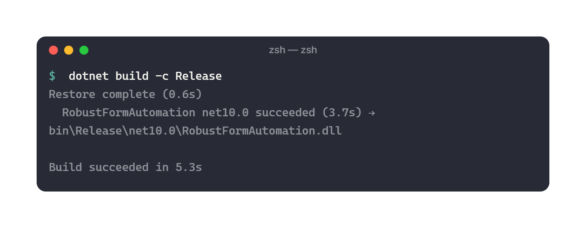
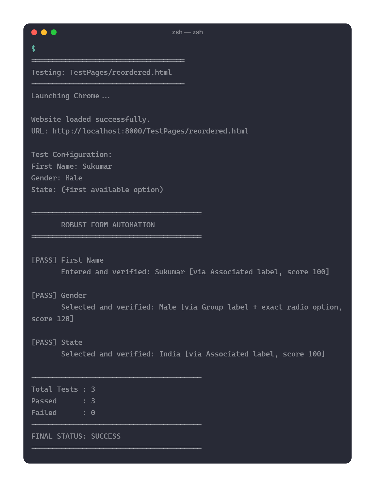
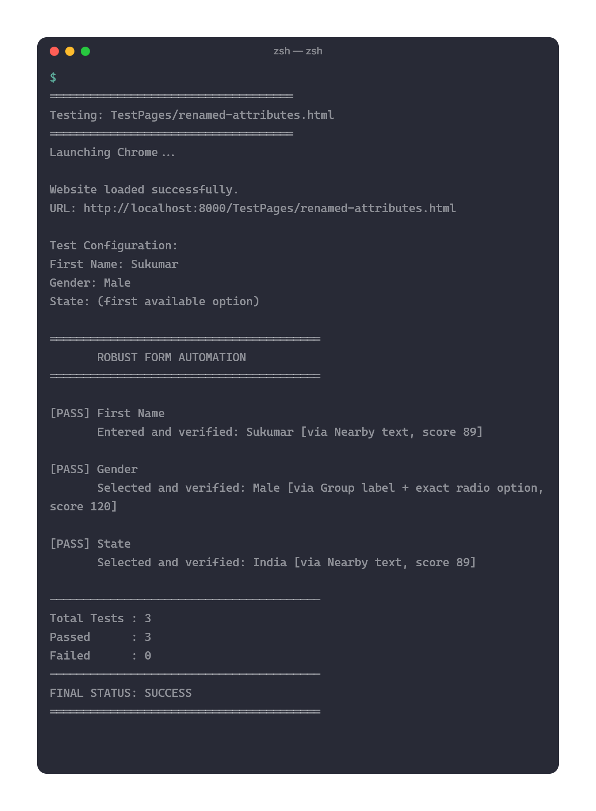
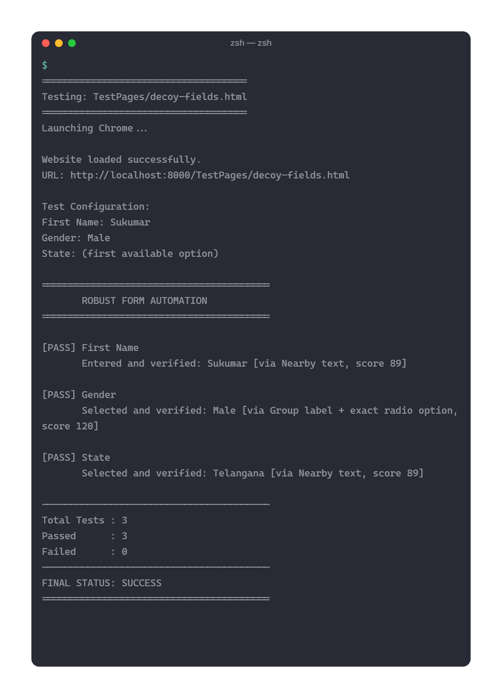

# Robust Form Automation – Test Execution & Screenshot Documentation

## 1. Project Information

| Item | Details |
|---|---|
| Project Name | Robust Form Automation |
| Programming Language | C# |
| Framework | .NET 10 |
| Automation Tool | Selenium WebDriver |
| Browser | Google Chrome |
| Testing Approach | Functional and HTML Structure Testing |
| Target Website | https://app.cloudqa.io/home/AutomationPracticeForm |
| Test Environment | Windows |
| Execution Mode | Headless Chrome |

---

## 2. Testing Objectives

The objective of testing is to evaluate the robustness and reliability of the Selenium automation framework under different HTML structures and modifications.

The testing covers:

- Identification of First Name, Gender, and State fields.
- Handling changes in HTML element order.
- Identification of fields with modified attributes.
- Detection of labels without explicit `for` associations.
- Handling nested HTML structures.
- Identification of radio groups and options.
- Avoidance of hidden, disabled, and misleading elements.
- Detection of ambiguous candidate matches.
- Verification of entered and selected values.
- Safe reporting of unsupported custom controls.

---

## 3. Test Environment

| Component | Configuration |
|---|---|
| Operating System | Windows |
| Runtime | .NET 10 |
| Programming Language | C# |
| Browser | Google Chrome |
| Automation Framework | Selenium WebDriver |
| Local Test Server | Python HTTP Server |
| Test Data | HTML fixtures |
| Build Configuration | Release |

---

## 4. Test Suite Overview

The project contains 13 HTML test pages divided into two groups.

### 4.1 Original Test Pages

| Test ID | Test Page | Test Scenario |
|---|---|---|
| TC-01 | `reordered.html` | Fields moved to different positions |
| TC-02 | `renamed-attributes.html` | Modified IDs, names, and HTML attributes |
| TC-03 | `decoy-fields.html` | Decoy and misleading form elements |

### 4.2 Additional Test Pages

| Test ID | Test Page | Test Scenario |
|---|---|---|
| TC-04 | `aria-labels.html` | ARIA-based field identification |
| TC-05 | `wrapped-labels.html` | Labels wrapping form controls |
| TC-06 | `plain-adjacent-labels.html` | Labels without explicit associations |
| TC-07 | `nested-layout.html` | Nested HTML structures |
| TC-08 | `text-node-labels.html` | Plain text nodes near form controls |
| TC-09 | `explicit-label-after-control.html` | Labels positioned after controls |
| TC-10 | `noise-hidden-decoys.html` | Hidden and disabled decoy elements |
| TC-11 | `state-default-option.html` | Automatic selection of a valid State option |
| TC-12 | `ambiguous-duplicate-fields.html` | Duplicate fields and ambiguity detection |
| TC-13 | `custom-dropdown-known-limit.html` | Custom dropdown interaction limitation |

---

## 5. Test Execution Results

The following results are based on the recorded execution output.

### 5.1 Original Test Pages

| Test ID | Test Page | First Name | Gender | State | Overall |
|---|---|---|---|---|---|
| TC-01 | reordered.html | PASS | PASS | PASS | PASS |
| TC-02 | renamed-attributes.html | PASS | PASS | PASS | PASS |
| TC-03 | decoy-fields.html | PASS | PASS | PASS | PASS |

**Observations:**

- Reordered fields were identified successfully.
- Modified HTML attributes did not prevent field resolution.
- Decoy fields were handled successfully using nearby text evidence and confidence scoring.
- The automation selected and verified all three requested fields.

### 5.2 Additional Test Pages

| Test ID | Test Page | First Name | Gender | State | Overall |
|---|---|---|---|---|---|
| TC-04 | aria-labels.html | PASS | PASS | PASS | PASS |
| TC-05 | wrapped-labels.html | PASS | PASS | PASS | PASS |
| TC-06 | plain-adjacent-labels.html | PASS | PASS | PASS | PASS |
| TC-07 | nested-layout.html | PASS | PASS | PASS | PASS |
| TC-08 | text-node-labels.html | PASS | PASS | PASS | PASS |
| TC-09 | explicit-label-after-control.html | PASS | PASS | PASS | PASS |
| TC-10 | noise-hidden-decoys.html | PASS | PASS | PASS | PASS |
| TC-11 | state-default-option.html | PASS | PASS | PASS | PASS |

**Observations:**

- ARIA labels and associated labels were used successfully.
- Wrapping and adjacent labels were detected.
- Nested layouts and plain text nodes were handled using nearby text evidence.
- Hidden and disabled decoy elements did not prevent successful field identification.
- When State was omitted from the configuration, the automation selected and verified the first available valid option.

### 5.3 Special Scenario Tests

#### TC-12: Ambiguous Duplicate Fields

| Field | Actual Result |
|---|---|
| First Name | Rejected due to ambiguous match |
| Gender | PASS |
| State | Rejected due to ambiguous match |

**Observation:**

The resolver identified two equally scoring candidates for First Name and State, both with a score of 100.

Instead of selecting an arbitrary element, it reported:

`Ambiguous match. Multiple candidates have similar scores.`

This demonstrates the ambiguity detection mechanism and its safe-rejection behavior.

**Evaluation:** Expected safe rejection. The application correctly avoided selecting an uncertain field. The execution report itself shows two failed interactions.

#### TC-13: Custom Dropdown

| Field | Actual Result |
|---|---|
| First Name | PASS |
| Gender | PASS |
| State | Reported unsupported custom dropdown |

**Observation:**

The automation successfully completed First Name and Gender interactions.

State was not selected because the detected control was a custom dropdown rather than a supported native HTML `<select>` element.

The application correctly reported:

`A custom dropdown was detected. Its interaction adapter is not implemented.`

**Evaluation:** Expected limitation. Custom dropdown interaction is not currently implemented.

---

## 6. Test Execution Summary

The recorded execution contains 39 individual field checks across 13 HTML pages.

| Metric | Actual Result |
|---|---:|
| Total HTML test pages | 13 |
| Total field checks | 39 |
| Successful field interactions | 36 |
| Ambiguous field rejections | 2 |
| Unsupported custom dropdown interactions | 1 |
| Fully successful HTML pages | 11 |
| Special scenario pages | 2 |

### Overall Interpretation

- 11 pages completed all three form interactions successfully.
- The ambiguity test correctly rejected two uncertain field matches while Gender passed.
- The custom dropdown test correctly identified the unsupported State interaction while First Name and Gender passed.
- The final execution status for the two special pages was reported as FAILED by the test runner because the expected rejections are represented as failed interactions.

The special scenario failures should be documented as expected behavior for these test objectives, not misrepresented as successful field interactions.

---

## 7. Build Verification

The project was compiled using the Release configuration.

**Command:**

```powershell
dotnet build -c Release
```

**Recorded Result:**

```text
Restore complete.

RobustFormAutomation net10.0 succeeded

Build succeeded.
```

The command `dotnet build --Release` was initially attempted but is not valid .NET CLI syntax. The correct command is `dotnet build -c Release`.

**Build Evaluation:** Successful.

---

## 8. Test Execution Logs

Individual execution outputs are stored in:

```text
test-results/
└── logs/
```

The test execution logs cover:

- Original HTML fixtures.
- ARIA label detection.
- Wrapping and adjacent label detection.
- Nested layouts.
- Text-node labels.
- Hidden and disabled decoys.
- Default State selection.
- Ambiguous duplicate fields.
- Custom dropdown limitations.

The combined execution output contains all 13 test-page runs.

---

## 9. Screenshot Documentation

The following five screenshots are maintained in the `screenshots/` directory.

### Screenshot 1 – Build Verification

**File:** `01-build_successfull.png`

**Purpose:** Demonstrates successful project compilation in Release configuration.



### Screenshot 2 – Reordered HTML Test

**File:** `02-reordered-page.png`

**Purpose:** Demonstrates automation against a modified HTML page where form fields appear in a different order.



### Screenshot 3 – Renamed Attributes Test

**File:** `03-renamed-attributes.png`

**Purpose:** Demonstrates field identification when HTML attributes such as IDs and names are changed.



### Screenshot 4 – Decoy Fields Test

**File:** `04-decoy-fields.png`

**Purpose:** Demonstrates how the resolver handles misleading form elements and uses nearby text and confidence scores to identify the requested fields.



### Screenshot 5 – CloudQA Website Automation

**File:** `05-cloudqa-automation.png`

**Purpose:** Provides visual evidence associated with the actual CloudQA automation demonstration.


---

## 10. Project Observations

The test results demonstrate that the framework can identify form controls through different types of DOM evidence.

The following observations were recorded:

1. Associated labels and ARIA labels provide strong identification evidence.
2. Nearby text detection supports fields without explicit label associations.
3. The framework can handle several changes in HTML order and attributes.
4. Confidence-based scoring helps rank candidate fields.
5. Ambiguity detection prevents arbitrary selection when candidates have similar scores.
6. Native HTML dropdown interaction is supported.
7. Custom dropdown interaction remains a known limitation.

---

## 11. Current Limitations

The implementation primarily supports conventional HTML form controls.

The following improvements remain possible:

- Custom dropdown interaction.
- Iframe discovery and switching.
- Improved support for hidden and visually styled radio buttons.
- Dynamic component interaction.
- Stale element recovery.
- Additional form control types.

The current resolver uses nearby text as heuristic evidence. Therefore, arbitrary HTML layouts may still produce insufficient confidence or ambiguous matches.

---

## 12. Conclusion

The test execution evaluates the Robust Form Automation framework against 13 different HTML test pages.

The framework successfully completed all three field interactions on 11 pages. Additional special scenarios demonstrated that the resolver can reject ambiguous candidates and report unsupported custom dropdowns instead of performing unsafe interactions.

The combination of DOM discovery, semantic metadata extraction, nearby text detection, confidence-based scoring, ambiguity checking, and browser-level verification provides a flexible foundation for Selenium form automation.

The execution logs and screenshots serve as supporting evidence for the implementation and its tested behavior.
